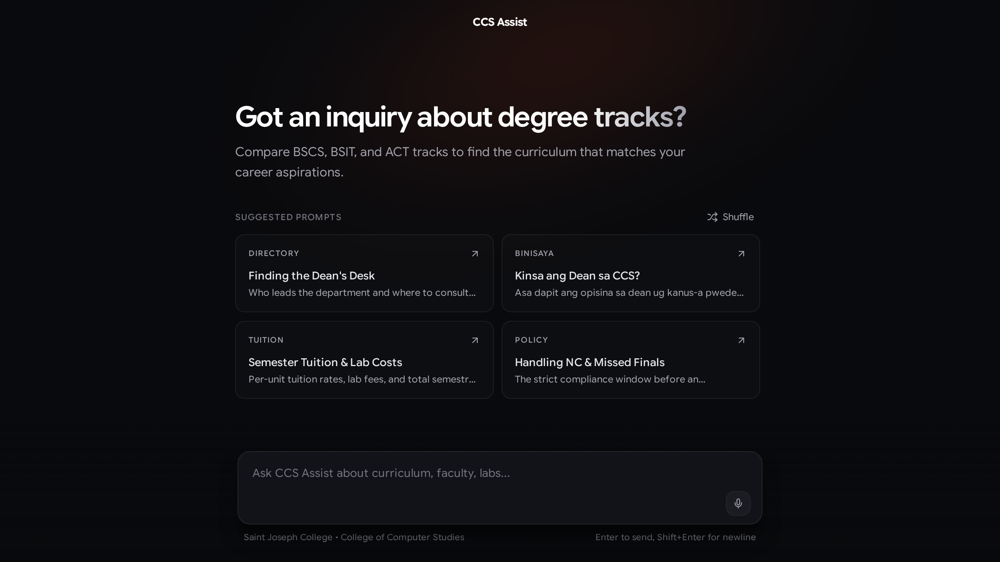

# ccs assist

an edge-powered ai assistant for the college of computer studies (ccs) at saint joseph college in maasin city. built so students can get instant answers on retention rules, curriculum prerequisites, dean's office hours, and enrollment steps without digging through handbooks or waiting in line.

> [**live assistant → ccs-assist.pages.dev**](https://ccs-assist.pages.dev)

## stack

- **sveltekit** (svelte 5 + runes) — reactive chat ui & edge api routes
- **cloudflare workers + vectorize** — edge embeddings & vector search (`@cf/baai/bge-base-en-v1.5`)
- **cloudflare d1** — serverless sqlite for knowledge chunk retrieval
- **groq lpus** — ultra-low latency inference (`qwen/qwen3.8-27b`) with workers ai fallback
- **typescript & tailwind**

## how it works

- **edge rag**: official department policies, course prerequisites, and faculty directories live as markdown chunks embedded into cloudflare vectorize and stored in d1.
- **scope lock & zero jailbreaks**: queries get embedded and similarity-checked against vectorize (`topK = 5`). if score < 0.35, it drops an instant polite refusal without hitting an llm — zero hallucination, zero token waste on random prompts.
- **failover pipeline**: streams tokens from groq for near-instant responses. if groq hits a 429 rate limit, it automatically falls back to native cloudflare workers ai (`llama-3.1-8b`) so live demos never go down.

## what it knows

- **retention rules**: 2.25 min gpa for 3rd year standing in bsit/bscs, fail limits, cat entrance cutoffs.
- **curriculum & prereqs**: full year-by-year subject maps for bsit, bscs, and 2-year act ladderized tracks.
- **campus & directory**: dean haidee galdo's office, department faculty roster, clinic, registrar locations.
- **enrollment**: the step-by-step 5-stage enrollment and advising workflow.

